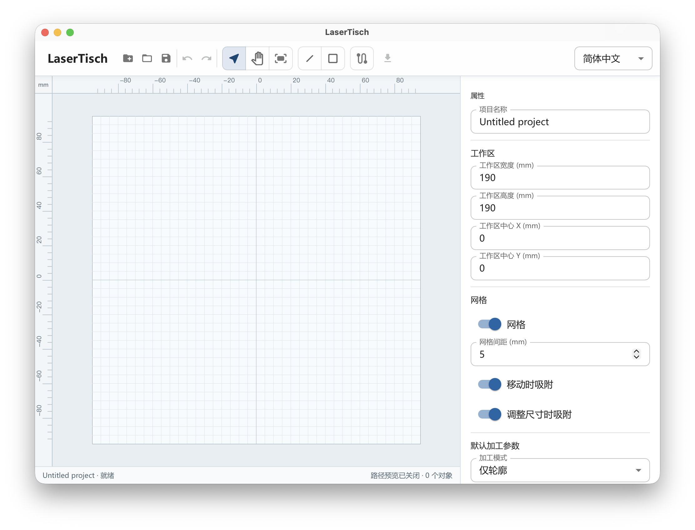
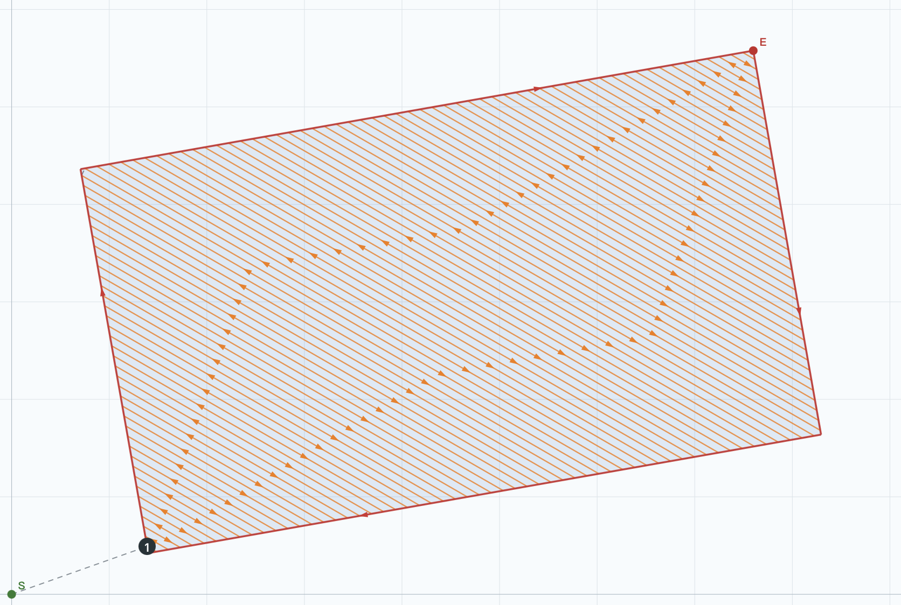

# LaserTisch

LaserTisch 是一款精密二维几何编辑与激光加工路径生成工具。它把图形编辑、加工参数、路径预览和设备文件导出集中在一个桌面应用中，适合直接准备矩形和线段类加工任务。

## 获取与启动

Windows 用户可从 GitHub 仓库页面右侧的 **Releases** 进入最新发布，在 **Assets** 中下载 `LaserTisch.exe`。双击即可启动，无需安装 Python、Node.js 或其他开发工具。程序不写入安装目录；项目文件和导出文件只会保存到你在系统对话框中选择的位置。

如果 Windows 提示缺少 [WebView2 Runtime](https://developer.microsoft.com/microsoft-edge/webview2)，请先安装微软提供的运行环境，再重新启动程序。

## 主要功能

- 在最大 `190 × 190 mm` 的工作区内绘制、选择、平移和编辑矩形、线段。
- 自定义工作区宽度、高度和世界坐标中心，支持负坐标。
- 通过属性面板精确修改位置、尺寸、端点和矩形旋转角度。
- 使用网格、移动吸附、缩放吸附和不遮挡图形的标尺辅助定位。
- 使用 `Shift` 绘制水平、垂直或 45° 线段以及正方形。
- 撤销、重做、删除对象，并调整对象的固定加工顺序。
- 设置轮廓、填充、填充后轮廓或轮廓后填充等加工方式。
- 设置加工速度、填充角度、扫描线间距和轮廓方向。
- 按需开启加工路径预览，区分激光加工、填充和空行程。
- 保存和打开 LaserTisch 项目文件，导出 CSV 或 DBD 设备文件。
- 在中文、英语、法语、德语和韩语之间切换界面语言。

## 界面预览

*主界面包含绘图工具、带标尺的工作区和实时属性面板。*

*旋转矩形的轮廓与世界坐标扫描填充路径预览。*

## 快速使用

1. 启动 `LaserTisch.exe`。
2. 使用工具栏中的线段或矩形工具绘图；完成一次绘制后，程序会自动回到选择工具。
3. 选中对象，在右侧属性面板调整几何数据和加工参数。修改会自动保存到当前项目状态。
4. 在右侧加工顺序列表中确认执行先后；导出时软件不会重新排序。
5. 需要检查路径时，开启工具栏中的加工路径预览。
6. 点击导出按钮，选择 CSV 或 DBD，并指定保存位置。
7. 使用保存按钮保留可再次编辑的 `.lasertisch.json` 项目文件。

## 常用快捷键

| 操作 | 快捷键 |
| --- | --- |
| 选择工具 | `V` |
| 平移工具 | `H` |
| 线段工具 | `L` |
| 矩形工具 | `R` |
| 适合工作区 | `Ctrl+0` |
| 保存项目 | `Ctrl+S` |
| 撤销 | `Ctrl+Z` |
| 重做 | `Ctrl+Y` |
| 删除选中对象 | `Delete` 或 `Backspace` |
| 取消选择并返回选择工具 | `Esc` |

macOS 使用 `Command` 代替表中的 `Ctrl`。

## 文件说明

- `.lasertisch.json`：可继续编辑的项目文件，包含工作区、图形、加工参数和加工顺序。
- `.csv`：便于人工查看的绝对坐标运动指令，字段为命令、目标坐标和速度。
- `.dbd`：目标设备使用的二进制加工文件。

每个导出的加工程序都以一次激光关闭、跳转到世界坐标原点的指令开始。线段按照起点到终点的方向加工，对象按照右侧列表中的顺序加工；程序结束后停留在最后一个目标点。

## 开发者资料

- [开发、调试与打包](docs/development.md)
- [架构与数据约束](docs/architecture.md)
- [Python 核心包说明](backend/README.md)

## 许可证

仓库当前未附带许可证文件。复制、分发或用于其他项目之前，请先取得项目所有者许可。

